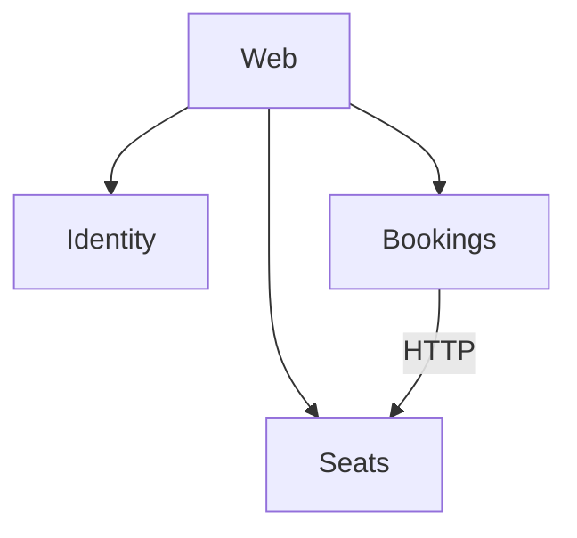

# ClubBooking

Учебный проект: бронирование мест в компьютерном клубе. Клиент выбирает дату, время начала и длительность, видит на карте свободные места и бронирует нужное. Администратор ведёт зоны и места, отмечает приход клиентов и закрывает места на ремонт.

## Технологический стек

- .NET 10, ASP.NET Core Web API (контроллеры), Entity Framework Core
- сайт на ASP.NET Core Razor Pages
- PostgreSQL
- Docker Compose
- xUnit, Testcontainers
- GitHub Actions

## Архитектура

Три сервиса (Identity, Seats, Bookings) и сайт Web. У каждого сервиса своя база в PostgreSQL. Bookings проверяет место и тариф у Seats по HTTP.

Подробно: [docs/ARCHITECTURE.md](docs/ARCHITECTURE.md)

## План работ

Этапы и сроки: [docs/PLAN.md](docs/PLAN.md)
