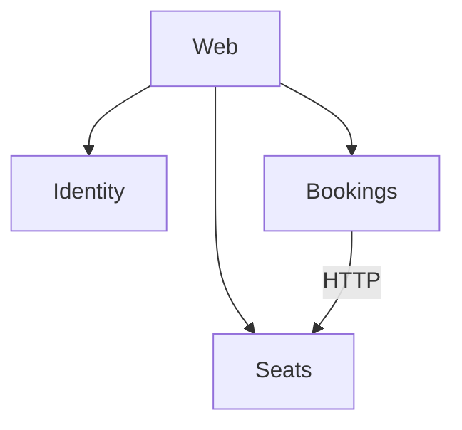

# ClubBooking

Учебный проект: бронирование мест в компьютерном клубе. Клиент выбирает дату, время начала и длительность, видит на карте свободные места и бронирует нужное. Администратор ведёт зоны и места, отмечает приход клиентов и закрывает места на ремонт.

## Технологический стек

- .NET 10, ASP.NET Core Web API (контроллеры), Entity Framework Core
- сайт на ASP.NET Core Razor Pages
- PostgreSQL
- Docker Compose
- xUnit, Testcontainers
- GitHub Actions

## Архитектура

Три сервиса (Identity, Seats, Bookings) и сайт Web. У каждого сервиса своя база в PostgreSQL. Bookings проверяет место и тариф у Seats по HTTP.



Подробно: [docs/ARCHITECTURE.md](docs/ARCHITECTURE.md)

## Быстрый старт

Нужен Docker Desktop. Для тестов и разработки ещё .NET 10 SDK (в моём случае Visual Studio 2026).

Запуск из корня репозитория:

```
docker compose up --build
```

| Что | Адрес |
|---|---|
| Сайт | http://localhost:8080 |
| Identity, Swagger | http://localhost:5001/swagger |
| Seats, Swagger | http://localhost:5002/swagger |
| Bookings, Swagger | http://localhost:5003/swagger |

## Тесты и CI

Тесты запускаются командой `dotnet test` из корня репозитория. Для тестов с базой нужен запущенный Docker, они сами поднимают PostgreSQL в контейнере. Сборка и тесты запускаются в GitHub Actions на каждый push в main и на каждый Pull Request.

## Структура репозитория

- `ClubBooking.Identity`: регистрация, вход и роли
- `ClubBooking.Seats`: зоны и места
- `ClubBooking.Bookings`: брони и правила бронирования
- `ClubBooking.Web`: сайт на Razor Pages
- `ClubBooking.Seats.Tests`: тесты
- `docs`: план работ и описание архитектуры
- `compose.yaml`: запуск всей системы

## План работ

Этапы и сроки: [docs/PLAN.md](docs/PLAN.md)
