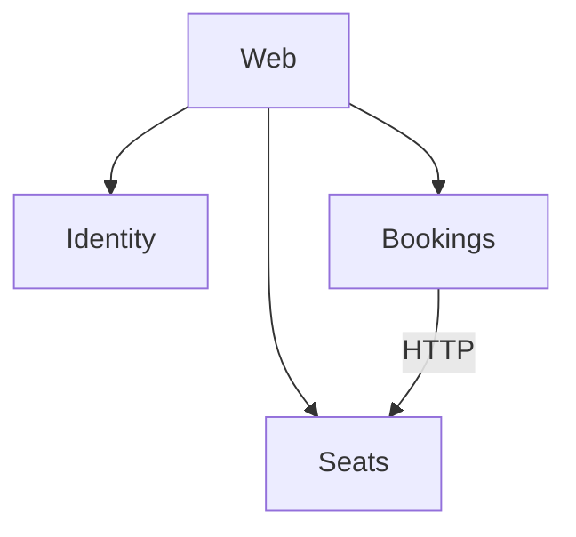
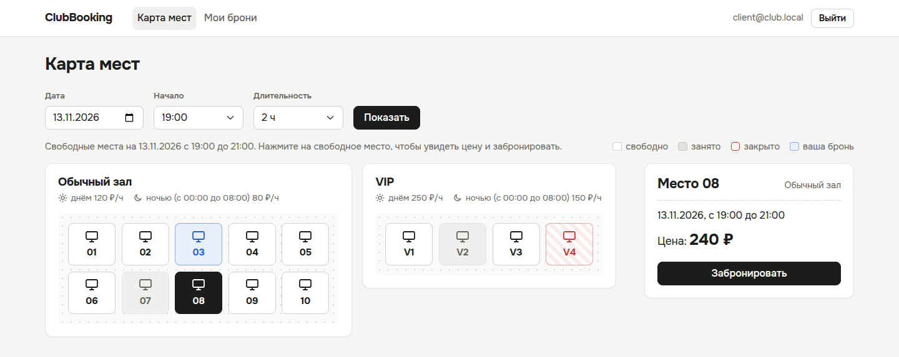

# ClubBooking

Учебный проект: бронирование мест в компьютерном клубе. Клиент выбирает дату, время начала и длительность, видит на карте свободные места и бронирует нужное. Администратор ведёт зоны и места, отмечает приход клиентов и закрывает места на ремонт.

## Технологический стек

- .NET 10, ASP.NET Core Web API (контроллеры), Entity Framework Core
- сайт на ASP.NET Core Razor Pages
- PostgreSQL
- Docker Compose
- xUnit, Testcontainers
- GitHub Actions

## Архитектура

Три сервиса (Identity, Seats, Bookings) и сайт Web. У каждого сервиса своя база в PostgreSQL. Bookings проверяет место и тариф у Seats по HTTP.



Подробно: [docs/ARCHITECTURE.md](docs/ARCHITECTURE.md)

## Быстрый старт

Нужен Docker Desktop. Для тестов и разработки ещё .NET 10 SDK (в моём случае Visual Studio 2026).

Запуск из корня репозитория:

```
docker compose up --build
```

| Что | Адрес |
|---|---|
| Сайт | http://localhost:8080 |
| Identity, Swagger | http://localhost:5001/swagger |
| Seats, Swagger | http://localhost:5002/swagger |
| Bookings, Swagger | http://localhost:5003/swagger |

Тестовые учётные записи (только для демонстрации):

| Роль | Email | Пароль |
|---|---|---|
| Администратор | admin@club.local | admin123 |
| Клиент | client@club.local | client123 |

Можно зарегистрировать и своего клиента на странице регистрации.



## Реализованная функциональность

- регистрация и вход, роли клиента и администратора;
- карта мест по зонам: свободные, занятые, закрытые и свои места на выбранное время;
- цена до бронирования по дневному и ночному тарифу зоны;
- бронирование от 1 до 5 часов с началом в 00 или 30 минут, не больше 2 будущих броней у клиента;
- две брони на одно место в одно время невозможны даже при одновременных запросах;
- отмена брони не позже чем за 1 час до начала;
- отметка прихода администратором, без прихода бронь снимается через 15 минут после начала;
- зоны: добавление, изменение и удаление, места: добавление, изменение и закрытие на ремонт.

## Тесты и CI

Тесты запускаются командой `dotnet test` из корня репозитория. Для тестов с базой нужен запущенный Docker, они сами поднимают PostgreSQL в контейнере.

- `ClubBooking.Bookings.Tests`: правила бронирования (длительность, начало, лимит, отмена, приход, неявка, цена) и API броней, в том числе две одновременные брони одного места;
- `ClubBooking.Seats.Tests`: API зон и мест, права администратора, health check;
- `ClubBooking.Identity.Tests`: регистрация и вход.

Сборка и тесты запускаются в GitHub Actions на каждый push в main и на каждый Pull Request.

## Структура репозитория

- `ClubBooking.Identity`: регистрация, вход и роли
- `ClubBooking.Seats`: зоны и места
- `ClubBooking.Bookings`: брони и правила бронирования
- `ClubBooking.Web`: сайт на Razor Pages
- `ClubBooking.*.Tests`: тесты сервисов
- `docs`: план работ и описание архитектуры
- `compose.yaml`: запуск всей системы

## План работ

Этапы и сроки: [docs/PLAN.md](docs/PLAN.md)

## Ограничения и планы развития

- нет API Gateway, сайт обращается к сервисам напрямую;
- нет оплаты и уведомлений;
- при закрытии места уже созданные брони не отменяются автоматически;
- можно добавить отмену брони администратором и историю посещений клиента.
