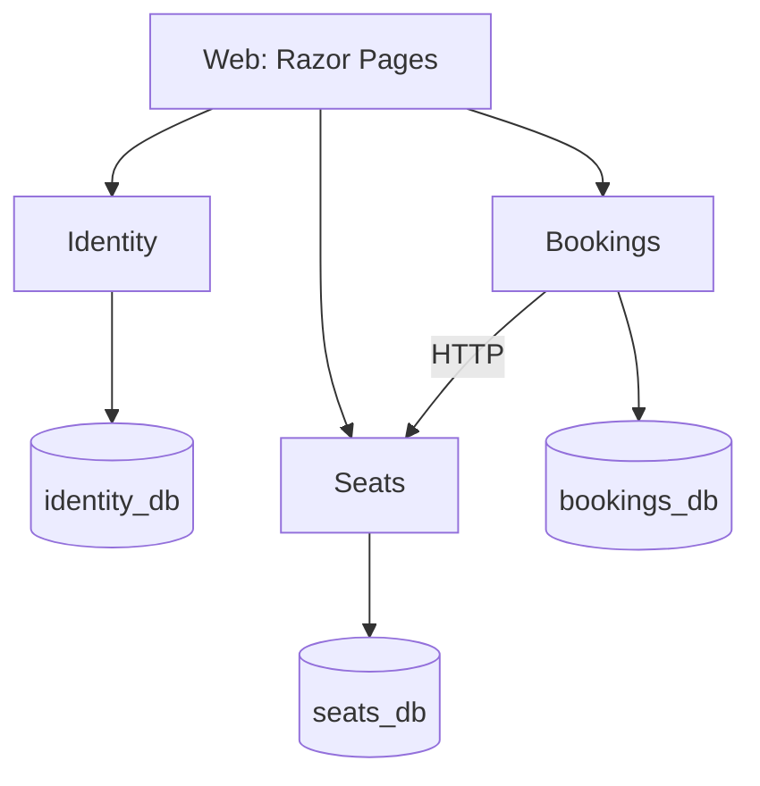
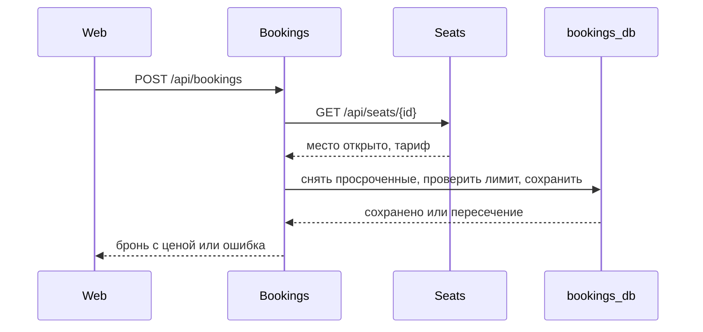

# Архитектура системы

## 1. Цель и контекст

Система бронирования мест в круглосуточном компьютерном клубе. Клиент выбирает дату, время и длительность, смотрит на карте свободные места и бронирует нужное. Администратор ведёт зоны и места, отмечает приход клиентов и закрывает места на ремонт.

## 2. Требования

- бронь создаётся только на будущее время, длится от 1 до 5 часов и начинается в 00 или 30 минут;
- брони на одно место не пересекаются, даже при одновременных запросах;
- если клиент не пришёл в течение 15 минут после начала, бронь снимается;
- приход отмечают не раньше чем за 15 минут до начала и не позже 15 минут после;
- отменить бронь можно не позже чем за 1 час до начала;
- у клиента не больше 2 будущих броней;
- каждые полчаса стоят половину часового тарифа зоны, дневного или ночного (ночь с 00:00 до 08:00);
- закрытое место нельзя забронировать, уже созданные на нём брони остаются;
- на сайте время по часам клуба, в базах в UTC, оплаты нет.

## 3. Общая схема

Линии означают запросы по HTTP и подключения к базам. Все три базы находятся в одном контейнере PostgreSQL.

## 4. Описание сервисов

**Identity.** Регистрация и вход, выдаёт JWT с ролью `client` или `admin`. Эндпоинты: `POST /api/auth/register`, `POST /api/auth/login`. База `identity_db`.

**Seats.** Зоны с дневным и ночным тарифом, места с рядом и колонкой на карте. Эндпоинты: `/api/zones` и `/api/seats` (читают все, меняет admin), `POST /api/seats/{id}/close` и `/open`. База `seats_db`.

**Bookings.** Брони и правила бронирования в классе `BookingRules`, который проверяется тестами без базы. Эндпоинты: `GET /api/bookings/busy` (занятые места), `GET /api/bookings/price` (цена до бронирования), `POST /api/bookings`, `GET /api/bookings/my`, `POST /api/bookings/{id}/cancel`, для admin `GET /api/bookings/today` и `POST /api/bookings/{id}/checkin`. База `bookings_db`.

**Web.** Сайт на Razor Pages: вход, регистрация, карта мест, мои брони, зоны и места, брони на сегодня. Вход идёт через Identity, полученный JWT сайт хранит в cookie с флагом HttpOnly и сам обращается к сервисам со стороны сервера.

## 5. Модель данных

- `identity_db.users`: email, хеш пароля, роль;
- `seats_db.zones`: название, дневной и ночной тариф;
- `seats_db.seats`: зона, номер, ряд, колонка, открыто ли место;
- `bookings_db.bookings`: клиент (id и email), место (id, номер и зона на момент брони), начало и конец в UTC, цена, статус (`Booked`, `CheckedIn`, `Cancelled`, `NoShow`), время прихода.

Пересечение броней `Booked` и `CheckedIn` на одном месте запрещает exclusion constraint в PostgreSQL.

## 6. Взаимодействие сервисов

Сервисы общаются только по HTTP. Создание брони:

Фоновой задачи нет. При чтении просроченная бронь считается `NoShow`, а перед новой бронью на том же месте её статус обновляется в той же транзакции. Лимит в 2 брони проверяется под блокировкой по клиенту (advisory lock в PostgreSQL).

## 7. Безопасность

- Identity выдаёт JWT с ролью, остальные сервисы проверяют его по общему ключу.
- В базе хранится не пароль, а его хеш (`PasswordHasher` из ASP.NET Core Identity).
- Клиент видит и отменяет только свои брони. Изменение зон и мест, брони на сегодня и отметка прихода доступны только администратору.

## 8. Развёртывание и конфигурация

Docker Compose поднимает `postgres`, `identity`, `seats`, `bookings` и `web`. Сайт открывается на http://localhost:8080, Swagger сервисов на портах 5001, 5002 и 5003. При старте каждый сервис применяет миграции, у каждого есть `/health`. Для демонстрации все значения уже заданы в `compose.yaml`, файл `.env` не нужен.

## 9. Принятые решения

- **Одна база на сервис в одном контейнере PostgreSQL**, а не контейнер на каждую базу: проще запуск, данные всё равно разделены.
- **Пересечения проверяет база**, а не код: при двух одновременных запросах пройдёт только одна бронь.
- **Правила в классе `BookingRules`**, а не в контроллере: их легко покрыть тестами.
- **Bookings спрашивает место у Seats при каждой брони**, а не хранит копию мест: закрытое место и новый тариф сразу учитываются.

## 10. Ограничения и развитие

- нет API Gateway, оплаты, уведомлений и группового бронирования;
- каждый сервис запускается в одном экземпляре;
- при закрытии места уже созданные брони не отменяются автоматически.
